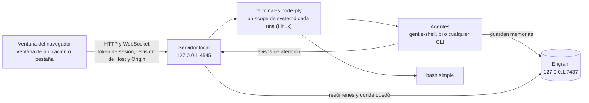
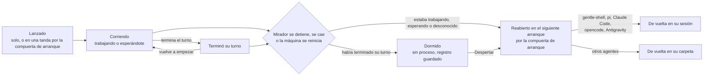

# Mirador

Mirador es un dashboard web local para correr muchos agentes de programación en una máquina Linux o WSL2 sin llenar su memoria. Cuando abres varios agentes de una vez, los inicia por lotes y espera a que haya memoria libre, deja dormidos tras un reinicio a los que habían terminado y muestra dónde quedó cada proyecto.

- **Memoria:** una compuerta de arranque para los agentes abiertos seguidos; los agentes que pueden retomar su sesión se duermen tras 4 h con su turno terminado (configurable en [Ajustes](docs/resources.md#idle-sleep), en minutos), y tras un reinicio todo agente que había terminado sigue dormido; en Linux, un scope de systemd por agente.
- **Dónde quedó:** cada proyecto muestra dónde se detuvo su última sesión.
- **Se queda en la máquina:** sin telemetría, sin cuentas, el servidor escucha solo en 127.0.0.1.

[](https://github.com/mata-2p/mirador/actions/workflows/test.yml) [](https://github.com/sponsors/mata-2p) [](https://ko-fi.com/matiasjbarriah) [](LICENSE)

[English](README.md) · Español

[Por qué Mirador](#por-qué-mirador) · [Inicio rápido](#inicio-rápido) · [Qué hace](#qué-hace) · [Cada agente](#qué-hace-mirador-con-cada-agente) · [Cómo se compara Mirador](#cómo-se-compara-mirador) · [Cómo funciona](#cómo-funciona) · [Configuración](#configuración) · [Desarrollo](#desarrollo) · [Guía de instalación](docs/install.md)


## Por qué Mirador

En qué se enfoca Mirador:

- **Memoria.** Antes de la compuerta de arranque, abrir 11 agentes de una vez llenó 24 GB de RAM y la swap, y systemd-oomd mató agentes y la ventana de Mirador. Ahora una [compuerta de arranque](docs/agents.md#opening-many-agents-without-filling-the-memory) retiene a los agentes abiertos seguidos mientras MemAvailable está bajo la reserva. Los agentes que pueden retomar su sesión se duermen tras 4 h con su turno terminado (configurable en [Ajustes](docs/resources.md#idle-sleep), en minutos), y tras un reinicio todo agente que había terminado sigue dormido; en Linux cada agente tiene [un scope de systemd](docs/agents.md#one-systemd-scope-per-terminal), así que una muerte por falta de memoria se lleva un agente.
- **Dónde quedó.** Cada proyecto muestra dónde se detuvo su última sesión, desde Engram o los últimos mensajes de Claude Code ([detalles](docs/attention.md#where-it-left-off)); una [vista de seguimiento](docs/attention.md#tracking-view) acompaña el día.
- **Para quienes usan gentle-shell.** Un [turno de noche](docs/extending.md#night-shift) cuyo piloto automático responde las preguntas de los agentes mientras no estás, y [servidores MCP por proyecto](docs/agents.md#mcp-servers-per-project) para apagar los que una carpeta no necesita.

La vista de seguimiento, y después la bandeja de atención y el panel **Dónde quedó** de una carpeta, en el workspace de demostración; cada una se abre a tamaño completo:

<p><a href="docs/img/tracking.png"></a></p>

<p><a href="docs/img/inbox.png"></a> <a href="docs/img/left-off.png"></a></p>

Mirador es un proyecto independiente, no una parte oficial de gentle-shell; se apoya en [gentle-shell](https://github.com/Gentleman-Programming/gentle-shell), pi y Engram, y agradece a esa comunidad.

## Inicio rápido

Este camino no necesita gentle-shell ni Engram: cada carpeta abre un `bash` simple, y los extras de Gentle quedan ocultos.

En Linux x64 y arm64 con glibc 2.28 o más reciente, una línea instala el release precompilado, sin nada que compilar; en otros sistemas instala desde el código fuente. Lee [el script](scripts/bootstrap.sh) antes de correrlo:

```sh
curl -fsSL https://raw.githubusercontent.com/mata-2p/mirador/main/scripts/bootstrap.sh | sh
```

**Arrancarlo.** Después de la instalación en una línea del release precompilado, `bin/mirador` es `~/.local/share/mirador/current/bin/mirador`; después de la instalación en una línea desde el código fuente es `~/.local/share/mirador/bin/mirador`. En Linux el instalador también enlaza `~/.local/bin/mirador`, así que `mirador` funciona desde cualquier carpeta una vez que `~/.local/bin` está en el `PATH` (el instalador avisa cuando no lo está). `bin/mirador stop` lo detiene.

**La carpeta del workspace.** Mirador muestra las carpetas dentro del `root` de cada workspace. En el primer arranque, sin archivo de configuración todavía, muestra un workspace, Dev, sobre `~/Dev`, o sobre tu carpeta personal cuando `~/Dev` no existe. Para agregar otro, haz clic en **Agregar** junto a **Workspaces** en la barra lateral; en **Agregar un workspace**, escribe la **Carpeta** (la ruta completa de una carpeta que exista; `~` es tu carpeta personal) y, si quieres, un **Nombre (opcional)**, y haz clic en **Agregar workspace**. Mirador escribe los workspaces en `~/.config/mirador/config.json` la primera vez que cambias uno desde la app. La instalación desde el código fuente escribe ese archivo al instalar: [The workspace folder](docs/install.md#the-workspace-folder) (en inglés).

**Idioma.** La interfaz sigue el idioma del navegador (español para `es-*`, inglés en otro caso) hasta que eliges uno en **Ajustes** (el botón de los controles deslizantes, arriba a la derecha) → **Idioma**, con **EN** o **ES**.

Todo lo demás, desde los requisitos y la instalación desde el código fuente hasta macOS, WSL2, los pasos manuales, los modos y el informe del doctor, está en [docs/install.md](docs/install.md) (en inglés).

## Qué hace

<picture>
  <source media="(prefers-color-scheme: dark)" srcset="docs/img/overview-dark.png">
  
</picture>

Un panel local para las carpetas de tus proyectos, con terminales de agentes adentro. Cada fila enlaza a la descripción completa en `docs/` (en inglés).

| Capacidad | En una frase |
|-----------|--------------|
| [Dónde quedó](docs/attention.md#where-it-left-off) | **Dónde quedó** muestra el último día trabajado de cada carpeta y los próximos pasos del resumen de su última sesión, leídos de Engram, o el último mensaje de Claude Code y el tuyo cuando es más reciente, guardados localmente por 30 días (`leftOffDays`). |
| [Vista de seguimiento](docs/attention.md#tracking-view) | **Seguimiento** cambia el diseño por una vista general de solo lectura de los agentes en carriles según lo que necesitan de ti. |
| [Bandeja de atención](docs/attention.md#attention-inbox) | **Te esperan (N)** lista las terminales de agentes que necesitan tu respuesta o terminaron su turno. |
| [Un scope de systemd por terminal](docs/agents.md#one-systemd-scope-per-terminal) | En Linux cada terminal corre en su propio scope de usuario de systemd, así que una muerte por falta de memoria se lleva una terminal, no todas. |
| [Compuerta de arranque según la memoria](docs/agents.md#opening-many-agents-without-filling-the-memory) | Los agentes abiertos seguidos arrancan en tandas y esperan mientras la memoria libre está bajo la reserva. |
| [Agentes dormidos](docs/agents.md#sleeping-agents-lazy-restore) | Después de un reinicio, todo agente que había terminado su turno duerme sin proceso hasta que lo despiertas; mientras Mirador corre, un agente Pi, Claude Code, opencode o Antigravity que lleva 4 h con su turno terminado (se ajusta en Ajustes, en minutos) también se duerme, si ya registró una sesión para retomar; Pi guarda primero el resumen de su sesión ([idle sleep](docs/resources.md#idle-sleep), en inglés). |
| [Reabrir tras un reinicio](docs/agents.md#reopening-agents-after-a-restart) | Los agentes abiertos vuelven en el siguiente arranque, en su carpeta y, con gentle-shell, pi, Claude Code, opencode o Antigravity, en su sesión. |
| [Abrir varios agentes](docs/agents.md#opening-several-agents) | Marca carpetas en el modo de selección, o guárdalas como los proyectos del workspace, y abre un agente en cada una. |
| [Servidores MCP por proyecto](docs/agents.md#mcp-servers-per-project) | Apaga los servidores MCP que una carpeta no necesita, lo que ahorra memoria en cada agente que se abre ahí. |
| [Ventana del navegador](docs/configuration.md#browser) | Un navegador de la familia Chromium abre Mirador como ventana de aplicación, sin necesitar GPU, Vulkan ni sesión de escritorio; cualquier otro navegador recibe una pestaña, la clave `browser` cambia la elección, y dentro de WSL2 se abre en el navegador de Windows. |
| [Cambios](docs/features.md#what-it-does) | **Cambios** muestra los cambios de una carpeta o de un workspace respecto de su último commit, preparados y sin preparar juntos, con el diff de cada archivo coloreado por línea; solo lee el repositorio. |
| [Avisos del navegador](docs/attention.md#attention-inbox) | Apagados hasta que haces clic en **Activar avisos del navegador** en la bandeja; desde entonces, un agente que empieza a esperarte o se detiene con un error muestra un aviso del navegador, con el ícono de Mirador, el proyecto y el motivo como título y la pregunta, el agente y la ruta en el cuerpo (puede llegar hasta 1,5 s después de la tarjeta, y 3 o más en 1,5 s comparten un aviso; un modo discreto oculta los detalles), y los turnos terminados nunca avisan. |
| [Turno de noche](docs/extending.md#night-shift) | En el modo completo, el **Piloto automático** responde las preguntas de los agentes mientras no estás, según un horario o encendido a mano, te deja las acciones sensibles y registra cada paso en la vista de seguimiento. |
| [Editor de archivos](docs/features.md#file-editor) | **Archivos** edita los archivos de texto de una carpeta, primero los archivos dotenv, y pregunta antes de sobrescribir el cambio de un agente. |
| [Seguridad](docs/security.md#security) | Sin telemetría y sin cuenta; el servidor escucha solo en `127.0.0.1` y revisa un token de sesión, el encabezado `Host` y, en cada cambio, el `Origin` propio de la aplicación ([qué se queda en la máquina](docs/security.md#what-stays-on-the-machine)). |

Para abrir Mirador desde otra máquina, reenvía su puerto con `ssh -L` después de leer los riesgos: [Opening Mirador from another machine](docs/security.md#opening-mirador-from-another-machine).

Los workspaces, el árbol de carpetas, las terminales como pestañas o en grilla, el resumen diario, los ajustes del turno de noche y los perfiles de recursos están en [docs/features.md](docs/features.md). Para contribuir: [CONTRIBUTING.md](CONTRIBUTING.md); para reportar una vulnerabilidad: [SECURITY.md](SECURITY.md).

## Qué hace Mirador con cada agente

Los agentes que Mirador conoce, desde [`src/agents/catalog.ts`](src/agents/catalog.ts), en su orden; también se abren un `bash` simple y cualquier `agentCommand` que configures ([modos](docs/install.md#modes), en inglés). Un agente que informa su estado recibe las tarjetas de te espera y de terminado.

| Agente | Comando | Informa su estado | Retoma su sesión tras un reinicio | Se duerme |
|---|---|---|---|---|
| Pi (gentle-shell) | `gentle-shell` | Sí | `--session <file>` | Tras 4 h inactivo, y tras un reinicio |
| Claude Code | `claude` | Sí | `--resume <id>` | Tras 4 h inactivo, y tras un reinicio |
| opencode | `opencode` | Sí | `--session <id>` | Tras 4 h inactivo, y tras un reinicio |
| Antigravity | `agy` | Sí | `--conversation <id>` | Tras 4 h inactivo, y tras un reinicio |
| Codex | `codex` | No | No, empieza de cero | No |
| Gemini CLI | `gemini` | No | No, empieza de cero | No |
| Kimi | `kimi` | No | No, empieza de cero | No |

opencode informa su estado y retoma su sesión desde la 2.0.0; un opencode anterior (1.x) arranca como Codex, sin informar, sin retomar y sin dormirse, y `mirador doctor` lo avisa.

Solo se duerme un agente que informa que terminó su turno, así que los que no informan nada se reabren en cada arranque y nunca se duermen. Los que sí lo informan se duermen mientras Mirador corre ([idle sleep](docs/resources.md#idle-sleep), en inglés) y tras un reinicio ([sleeping agents](docs/agents.md#sleeping-agents-lazy-restore)). El dormir por inactividad para Claude Code, opencode y Antigravity llega en la 0.3.0; en la 0.2.0 solo los agentes Pi se duermen mientras Mirador corre.

## Cómo se compara Mirador

Otras herramientas también corren agentes de programación lado a lado.

| Quieres… | Mira |
|---|---|
| Ver qué agente te está esperando | Mirador, Herdr, Paradev, cmux, Emdash |
| Dónde quedó cada proyecto | Mirador |
| Agentes de vuelta en su sesión tras un reinicio | Mirador, Herdr TUI (activado por defecto), cmux (agentes cuyos hooks guardaron una sesión) |
| Agentes abiertos seguidos que esperan memoria libre, un scope de systemd por agente, y que tras un reinicio solo se reabran los que no habían terminado | Mirador |
| Agentes inactivos dormidos para liberar memoria | Mirador (los agentes que pueden retomar su sesión se duermen tras 4 h con su turno terminado (configurable en [Ajustes](docs/resources.md#idle-sleep), en minutos), y tras un reinicio todo agente que había terminado sigue dormido), cmux (`terminal.agentHibernation`, opcional), Herdr TUI (plugins de la comunidad) |
| Un turno de noche y servidores MCP por proyecto para gentle-shell | Mirador |
| Máquinas remotas por SSH | Herdr TUI, Herdr app, cmux (`cmux ssh`), Emdash (SSH/SFTP), Claude Code Desktop |
| Una app para el teléfono | Herdr app (iPhone, iPad, Android), Paradev (Apple, Android), Claude Code Desktop (app móvil de Claude), cmux (iPhone beta) |
| Agentes en worktrees de git | Paradev, Emdash, Claude Code Desktop (por sesión, apagados por defecto) |
| Una app de escritorio en macOS | Herdr app (Apple silicon), Paradev, Claude Code Desktop, cmux (app de terminal), Emdash |
| Una app de escritorio en Linux | Herdr app, Paradev, Claude Code Desktop (beta), Emdash |
| Una app de escritorio en Windows | Herdr app, Claude Code Desktop, Emdash |
| Una interfaz de terminal en un solo binario de Rust para macOS, Linux y Windows | Herdr TUI |

Herdr conviene si trabajas con varias máquinas, desde el teléfono o en macOS o Windows; Mirador conviene si todo corre en una máquina Linux o WSL2 y el límite es la memoria. Herdr cerró [herdrdev/herdr#6152](https://github.com/herdrdev/herdr/issues/6152) ("Add confirmation and a cap for large agent restores", pedir confirmación y un tope al restaurar muchos agentes) como "not planned" el 23-11-2026 y derivó la propuesta a sus discusiones de Ideas; en Herdr TUI, `[session] resume_agents_on_restore = false` apaga la reanudación automática de agentes y conserva la disposición. Mirador no tiene relación con Herdr: los nombres `herdr` en su código son una capa de compatibilidad con gentle-shell ([`bin/herdr-shim`](CONTRIBUTING.md#gentle-names-in-the-code)), y Mirador no incluye ni corre Herdr.

<details>
<summary>Lo que decía el sitio o repositorio de cada herramienta el 2026-11-26</summary>

La tabla muestra lo que decía el sitio o repositorio propio de cada una el 2026-11-26. Una raya significa que sus páginas oficiales no lo dicen, y "No" significa que dicen que no; el sitio de cada proyecto es la fuente de verdad y las cosas cambian.

| | **Mirador** | [Herdr TUI](https://github.com/herdrdev/herdr) | [Herdr app](https://herdr.dev) | [Paradev](https://paradev.com) | [Claude Code Desktop](https://code.claude.com/docs/en/desktop) | [cmux](https://github.com/manaflow-ai/cmux) | [Emdash](https://github.com/generalaction/emdash) (Classic) |
|---|---|---|---|---|---|---|---|
| Forma | Panel web¹ | App de terminal² | App de escritorio³ | App de escritorio⁴ | App de escritorio⁵ | App de terminal⁶ | App de escritorio |
| Plataformas | Linux, WSL2, macOS¹ | macOS, Linux, Windows beta² | macOS³, Linux, Windows | macOS, Linux⁴ | macOS, Windows, Linux beta⁵ | Solo macOS⁶ | macOS, Windows, Linux |
| Licencia | Apache-2.0 | Apache-2.0 | Apache-2.0 | MIT | — | GPL-3.0-or-later⁶ | Apache-2.0 |
| Agentes en worktrees de git | No | — | — | Sí | Opcional⁵ | — | Sí |
| Máquinas remotas y teléfono | [Túnel `ssh -L`](docs/security.md#opening-mirador-from-another-machine)¹ | SSH | SSH, apps móviles³ | Teléfono, nube⁴ | SSH, nube, teléfono⁵ | SSH, iPhone beta⁶ | SSH/SFTP |
| Sesiones de agentes tras un reinicio | Retomadas¹ | Activado por defecto² | No³ | — | — | Con hooks⁶ | — |
| Agentes inactivos dormidos | Agentes que retoman su sesión¹ | Plugins² | — | — | — | Opcional⁶ | — |

¹ Mirador: un panel web local en una ventana del navegador; macOS es experimental; sin app, pero la bandeja se puede usar en el navegador del teléfono a través del mismo túnel ([experimental](docs/attention.md#the-phone-inbox-is-experimental)); tras un reinicio los agentes de gentle-shell, pi, Claude Code, opencode y Antigravity retoman su sesión y los demás empiezan de cero en su carpeta; los agentes Pi, Claude Code, opencode y Antigravity se duermen por defecto tras 4 h con su turno terminado (se ajusta en Ajustes, en minutos), y tras un reinicio todo agente que había terminado sigue dormido.<br>
² Herdr TUI: un solo binario de Rust en la terminal; Windows está en beta; "Native agent session restore is enabled by default" (la restauración nativa de sesiones de agentes está activada por defecto; `[session] resume_agents_on_restore`, [session state](https://herdr.dev/docs/session-state/)); los agentes inactivos se duermen solo con plugins de la comunidad como herdr-idle y herdr-hibernate ([plugins](https://herdr.dev/tui/plugins/)).<br>
³ Herdr app: una app de escritorio nativa ([herdrdev/herdr-app](https://github.com/herdrdev/herdr-app)); macOS en Apple silicon; apps para iPhone, iPad y Android; tras un reinicio sus paneles vuelven como una shell, porque el FAQ dice que "doesn't restart an agent or resume its work in progress" (no reinicia un agente ni retoma su trabajo en curso).<br>
⁴ Paradev: también una CLI, un SDK y un servidor MCP; "Windows is not yet available" (Windows aún no está disponible); la app para el teléfono es para dispositivos Apple y Android.<br>
⁵ Claude Code Desktop: la pestaña Code de la app de escritorio de Claude; Linux beta para Ubuntu y Debian; worktrees por sesión, apagados por defecto; sesiones en la nube en claude.ai/code o en la app móvil de Claude, y una sesión local aparece en tus otros dispositivos con Remote Control en las apps de Claude.<br>
⁶ cmux: una app de terminal nativa de macOS, solo macOS por ahora; partes del servidor bajo BUSL-1.1; SSH con `cmux ssh`; la app para iPhone está en beta en TestFlight; "Supported agent sessions can resume when hooks have saved a native session ID" (las sesiones de agentes compatibles pueden retomarse cuando los hooks guardaron un ID de sesión nativo); `terminal.agentHibernation` mata los procesos de agentes inactivos en segundo plano para liberar RAM y CPU y los retoma después, apagado por defecto para la hibernación de rutina, aunque con presión de memoria crítica puede hibernar incluso apagado.

</details>

## Cómo funciona

Un servidor local, que arranca `mirador`, corre cada terminal con node-pty y sirve la interfaz a una ventana del navegador en la misma máquina. Los agentes avisan cuando te esperan, y Engram, cuando corre, aporta la memoria detrás de los resúmenes y de **Dónde quedó**. Los módulos y el flujo de datos están en [docs/how-it-works.md](docs/how-it-works.md).



La vida de un agente a través de los reinicios ([detalles](docs/agents.md#reopening-agents-after-a-restart)):



## Límites conocidos

- Sin scopes de systemd, `mirador stop` puede dejar vivos procesos que un agente arrancó en segundo plano ([#1](https://github.com/mata-2p/mirador/issues/1)). Los scopes están apagados con `MIRADOR_SCOPES=0`, con `scopes: false` en la configuración, en macOS, y en Linux o WSL2 donde `systemd-run --user --scope` no funciona.
- Una vez que viste la tarjeta de terminado o de error de un agente, la barra lateral, su pestaña y su panel lo muestran trabajando; Seguimiento sigue mostrando su estado real ([#12](https://github.com/mata-2p/mirador/issues/12)).

## Configuración

`~/.config/mirador/config.json`. Los cambios de workspace desde la interfaz escriben solo `workspaces`; todas las claves son opcionales:

```json
{
  "workspaces": [
    { "id": "dev", "name": "Dev", "root": "/home/you/Dev", "folders": ["tools", "web"], "expanded": ["web"] }
  ],
  "port": 4545,
  "engramUrl": "http://127.0.0.1:7437",
  "agentCommand": "gentle-shell",
  "ignore": ["node_modules", "bin", "obj", "dist", "build", "target", "coverage", "__pycache__"],
  "timeZone": "America/Santiago"
}
```

Qué hace cada clave, la elección manual de `browser`, los comandos (`mirador link | status | stop | logs`) y una configuración rota: [docs/configuration.md](docs/configuration.md). Los ajustes `launches` de la compuerta de arranque: [docs/agents.md](docs/agents.md#opening-many-agents-without-filling-the-memory).

Las terminales corren en scopes de systemd donde `systemd-run --user --scope` funciona. `MIRADOR_SCOPES=0` en el entorno, o `"scopes": false` en la configuración, los apaga: [One systemd scope per terminal](docs/agents.md#one-systemd-scope-per-terminal).

## Desarrollo

```sh
pnpm test                 # node --test 'test/**/*.test.ts'
```

Las funciones nuevas se conectan como un módulo de rutas y un módulo de interfaz cada una; [docs/extending.md](docs/extending.md) lista los helpers compartidos, los eventos, los espacios del DOM y las líneas en que cada función se registra. [docs/releasing.md](docs/releasing.md) es para quienes mantienen el proyecto: sacar un release, revisar su borrador y el PR de promoción que lo fija en `scripts/bootstrap.sh`. Los nombres de las herramientas Gentle que aparecen en el código, la configuración y `doctor` (gentle-ai, Engram, gentle-deck, `bin/herdr-shim`) se explican en [Gentle names](CONTRIBUTING.md#gentle-names-in-the-code).

## Autor

Mirador fue creado por Matías Barría ([@mata-2p](https://github.com/mata-2p)), fundador de [ZURAI](https://zurai.cl).
¿Necesitas software a medida o consultoría? Escríbele a ZURAI en [zurai.cl](https://zurai.cl).

## Licencia

Mirador se publica bajo la [Apache License 2.0](LICENSE). Puedes usarlo, modificarlo y redistribuirlo, también con fines comerciales, siempre que conserves el aviso ([NOTICE](NOTICE)); quienes contribuyen otorgan una licencia de patentes sobre sus contribuciones.

## Patrocinio

Mirador es gratis y se financia con donaciones: los niveles mensuales están en GitHub Sponsors y las propinas únicas en Ko-fi, ambos descritos en [SPONSORS.md](SPONSORS.md). Nada en la app es de pago, y no hay telemetría.
