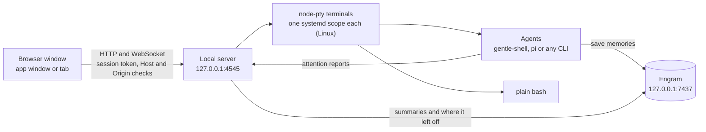
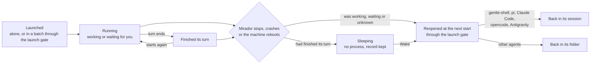

# Mirador

Mirador is a local web dashboard that keeps track of the coding agents running on your machine, folder by folder, so you can run several at once without losing the thread of any of them.

- **Where it left off:** each project shows where its last session stopped.
- **Resource control:** one systemd scope per agent, a launch gate for memory and idle agents that sleep (Linux).
- **Stays on the machine:** no telemetry, no accounts, the server listens on 127.0.0.1 only.

[](https://github.com/mata-2p/mirador/actions/workflows/test.yml) [](https://github.com/sponsors/mata-2p) [](https://ko-fi.com/matiasjbarriah) [](LICENSE)

English · [Español](README.es.md)

[Why Mirador](#why-mirador) · [Quickstart](#quickstart) · [What it does](#what-it-does) · [How Mirador compares](#how-mirador-compares) · [How it works](#how-it-works) · [Configuration](#configuration) · [Development](#development) · [Install guide](docs/install.md)


## Why Mirador

What Mirador focuses on:

- **Where it left off.** Each project shows where its last session stopped, from Engram or Claude Code's last messages ([details](docs/attention.md#where-it-left-off)); a [tracking view](docs/attention.md#tracking-view) follows the day.
- **Resource control.** [One systemd scope per agent](docs/agents.md#one-systemd-scope-per-terminal) (Linux), a [launch gate](docs/agents.md#opening-many-agents-without-filling-the-memory) that waits for free memory, [idle agents that sleep](docs/agents.md#sleeping-agents-lazy-restore) and [MCP servers per project](docs/agents.md#mcp-servers-per-project).
- **Back after a reboot.** Agents [come back](docs/agents.md#reopening-agents-after-a-restart) to their folder and, with gentle-shell, pi, Claude Code, opencode or Antigravity, to their session.
- **Mirador itself stays on the machine.** Zero telemetry, no accounts, and the server listens on `127.0.0.1` only ([what leaves it and what it keeps](docs/security.md#what-stays-on-the-machine)).
- **A browser window.** No GPU, Vulkan or desktop session needed, and inside WSL2 it opens in the Windows browser ([details](docs/configuration.md#browser)).
- **Native gentle-shell, pi and Engram integration**, while any terminal agent or a plain `bash` works too ([modes](docs/install.md#modes)).

The tracking view, then the attention inbox and a folder's **Where it left off** panel, in the demo workspace; each opens at full size:

<p><a href="docs/img/tracking.png"></a></p>

<p><a href="docs/img/inbox.png"></a> <a href="docs/img/left-off.png"></a></p>

Mirador is an independent project, not an official part of gentle-shell; it builds on [gentle-shell](https://github.com/Gentleman-Programming/gentle-shell), pi and Engram, and thanks that community.

## Quickstart

This path needs neither gentle-shell nor Engram: each folder opens a plain `bash`, and the Gentle extras stay hidden.

On Linux x64 and arm64 with glibc 2.28 or newer, one line installs the prebuilt release, with nothing to compile; on other systems it installs from source. Read [the script](scripts/bootstrap.sh) before running it:

```sh
curl -fsSL https://raw.githubusercontent.com/mata-2p/mirador/main/scripts/bootstrap.sh | sh
```

**Starting it.** After the one-line install of the prebuilt release, `bin/mirador` is `~/.local/share/mirador/current/bin/mirador`; after the one-line install from source it is `~/.local/share/mirador/bin/mirador`. On Linux the installer also links `~/.local/bin/mirador`, so `mirador` works from any folder once `~/.local/bin` is on `PATH` (the installer warns when it is not). `bin/mirador stop` stops it.

**The workspace folder.** Mirador shows the folders inside the `root` of each workspace. On the first start, with no config file yet, it shows one workspace, Dev, on `~/Dev`, or on your home folder when `~/Dev` does not exist. To add another, click **Add** next to **Workspaces** in the sidebar; in **Add a workspace**, type the **Folder** (the full path of an existing folder; `~` means your home folder) and, if you like, a **Name (optional)**, then click **Add workspace**. Mirador writes the workspaces to `~/.config/mirador/config.json` the first time you change one from the app. The install from source writes that file when it installs: [The workspace folder](docs/install.md#the-workspace-folder).

**Language.** The interface follows the browser's language (Spanish for `es-*`, English otherwise) until you choose one in **Settings** (the sliders button at the top right) → **Language**, with **EN** or **ES**.

Everything else, from the requirements and the install from source to macOS, WSL2, the manual steps, the modes and the doctor report, is in [docs/install.md](docs/install.md).

## What it does

<picture>
  <source media="(prefers-color-scheme: dark)" srcset="docs/img/overview-dark.png">
  
</picture>

A local dashboard for your project folders, with agent terminals inside it. Each row links to the full description in `docs/`.

| Capability | In one sentence |
|------------|-----------------|
| [Where it left off](docs/attention.md#where-it-left-off) | **Where it left off** shows each folder's last worked day and the next steps of its latest session summary, read from Engram, or Claude Code's last message and yours when that is newer, kept locally for 30 days (`leftOffDays`). |
| [Tracking view](docs/attention.md#tracking-view) | **Tracking** swaps the layout for a read-only overview of agents in lanes by what they need from you. |
| [Attention inbox](docs/attention.md#attention-inbox) | **Waiting for you (N)** lists the agent terminals that need your answer or finished their turn. |
| [One systemd scope per terminal](docs/agents.md#one-systemd-scope-per-terminal) | On Linux each terminal runs in its own systemd user scope, so an out-of-memory kill takes one terminal, not all of them. |
| [Launch gate for memory](docs/agents.md#opening-many-agents-without-filling-the-memory) | Agents opened in a row start in batches and wait while free memory is under the reserve. |
| [Sleeping agents](docs/agents.md#sleeping-agents-lazy-restore) | After a restart, agents that had finished their turn sleep with no process until you wake them. |
| [Reopening after a restart](docs/agents.md#reopening-agents-after-a-restart) | Open agents come back at the next start, in their folder and, with gentle-shell, pi, Claude Code, opencode or Antigravity, in their session. |
| [Opening several agents](docs/agents.md#opening-several-agents) | Mark folders in selection mode, or save them as the workspace's projects, and open one agent in each. |
| [MCP servers per project](docs/agents.md#mcp-servers-per-project) | Turn off the MCP servers a folder does not need, which saves memory in every agent opened there. |
| [Browser window](docs/configuration.md#browser) | A Chromium-family browser opens Mirador as an app window; any other browser gets a tab, and the `browser` key overrides the choice. |
| [Changes](docs/features.md#what-it-does) | **Changes** shows a folder's or workspace's changes against its last commit, staged and unstaged together, with each file's diff coloured by line; it only reads the repository. |
| [Browser notifications](docs/attention.md#attention-inbox) | Off until you click **Turn on browser notifications** in the inbox; then an agent that starts waiting for you or stops with an error shows one browser notification, with Mirador's icon, the project and reason as its title and the question, agent and path in its body (it may arrive up to 1.5 s after the card, and 3 or more within 1.5 s share one notification; a discreet mode hides the details), and finished turns never do. |
| [Night shift](docs/attention.md#tracking-view) | In the full mode, the **Autopilot** answers agents' questions while you are away, on a schedule or switched on by hand, leaves sensitive actions for you and reports each move in the tracking view. |
| [File editor](docs/features.md#file-editor) | **Files** edits a folder's text files, dotenv files first, and asks before overwriting an agent's change. |
| [Security](docs/security.md#security) | The server listens on `127.0.0.1` only and checks a session token, the `Host` header and, on every change, the app's own `Origin`. |

To open Mirador from another machine, forward its port with `ssh -L` after reading the risks: [Opening Mirador from another machine](docs/security.md#opening-mirador-from-another-machine).

Workspaces, the folder tree, terminals as tabs or a grid, the daily summary, the night shift's settings and resource profiles are in [docs/features.md](docs/features.md). Contributing: [CONTRIBUTING.md](CONTRIBUTING.md); reporting a vulnerability: [SECURITY.md](SECURITY.md).

## How Mirador compares

Other tools run coding agents side by side too.

| You want… | Look at |
|---|---|
| Where each local agent left off | Mirador |
| One systemd scope per agent, a launch gate for memory and idle agents that sleep (Linux) | Mirador |
| Agents back in their folder and session after a reboot | Mirador |
| A browser window with no GPU, Vulkan or desktop session, also inside WSL2 | Mirador |
| Native gentle-shell, pi and Engram integration | Mirador |
| Remote machines over SSH | Herdr, cmux (`cmux ssh`), Emdash (SSH/SFTP), Claude Code Desktop |
| A phone app | Herdr (iPhone, iPad, Android), Paradev (Apple, Android), Claude Code Desktop (Claude mobile app), cmux (iPhone beta) |
| Agents in git worktrees | Paradev, Emdash, Claude Code Desktop (per session, off by default) |
| A desktop app on macOS | Herdr (Apple silicon), Paradev, Claude Code Desktop, cmux (terminal app), Emdash |
| A desktop app on Linux | Paradev, Claude Code Desktop (beta), Emdash |
| A desktop app on Windows | Claude Code Desktop, Emdash |
| A terminal UI in one Rust binary for macOS, Linux and Windows | Herdr TUI |

If you need remote machines over SSH, a phone app or a single Rust binary (Herdr TUI, next to its native desktop app), [Herdr](https://herdr.dev) (Apache-2.0) does those today and Mirador does not. Mirador has no relation to Herdr: the `herdr` names in its code are a gentle-shell compatibility layer ([`bin/herdr-shim`](CONTRIBUTING.md#gentle-names-in-the-code)), and Mirador neither ships nor runs Herdr.

<details>
<summary>What each tool's own site or repository said on 2026-11-26</summary>

The table lists what each one's own site or repository said on 2026-11-26. A dash means its official pages do not say, and "No" means they say so; each project's site is the source of truth and things change.

| | **Mirador** | [Herdr](https://herdr.dev) | [Paradev](https://paradev.com) | [Claude Code Desktop](https://code.claude.com/docs/en/desktop) | [cmux](https://github.com/manaflow-ai/cmux) | [Emdash](https://github.com/generalaction/emdash) (Classic) |
|---|---|---|---|---|---|---|
| Form | Web dashboard¹ | Desktop app, TUI² | Desktop app³ | Desktop app⁴ | Terminal app⁵ | Desktop app |
| Platforms | Linux, WSL2, macOS¹ | macOS², Linux, Windows | macOS, Linux³ | macOS, Windows, Linux beta⁴ | macOS only⁵ | macOS, Windows, Linux |
| License | Apache-2.0 | Apache-2.0 | MIT | — | GPL-3.0-or-later⁵ | Apache-2.0 |
| Agents in git worktrees | No | — | Yes | Optional⁴ | — | Yes |
| Remote machines and phone | [`ssh -L` tunnel](docs/security.md#opening-mirador-from-another-machine)¹ | SSH, phone apps² | Phone, cloud³ | SSH, cloud, phone⁴ | SSH, iPhone beta⁵ | SSH/SFTP |

¹ Mirador: a local web dashboard in a browser window; macOS is experimental; no app, but the inbox is usable on a phone's browser through the same tunnel ([experimental](docs/attention.md#the-phone-inbox-is-experimental)).<br>
² Herdr: a native desktop app plus Herdr TUI in the terminal, one Rust binary for macOS, Linux and Windows; macOS on Apple silicon; phone apps for iPhone, iPad and Android.<br>
³ Paradev: also a CLI, an SDK and an MCP server; "Windows is not yet available"; the phone app is for Apple and Android devices.<br>
⁴ Claude Code Desktop: the Code tab of the Claude desktop app; Linux beta for Ubuntu and Debian; worktrees per session, off by default; cloud sessions in claude.ai/code or the Claude mobile app, and a local session shows up on your other devices through Remote Control in the Claude apps.<br>
⁵ cmux: a native macOS terminal app, macOS only for now; server parts under BUSL-1.1; SSH through `cmux ssh`; the iPhone app is in beta on TestFlight.

</details>

## How it works

One local server, started by `mirador`, runs every terminal with node-pty and serves the UI to a browser window on the same machine. Agents report when they wait for you, and Engram, when it runs, supplies the memory behind the summaries and **Where it left off**. The modules and the data flow are in [docs/how-it-works.md](docs/how-it-works.md).



An agent's life across restarts ([details](docs/agents.md#reopening-agents-after-a-restart)):



## Known limits

- Without systemd scopes, `mirador stop` can leave alive processes an agent started in the background ([#1](https://github.com/mata-2p/mirador/issues/1)). Scopes are off with `MIRADOR_SCOPES=0`, with `scopes: false` in the config, on macOS, and on Linux or WSL2 where `systemd-run --user --scope` does not work.
- Once you have seen an agent's finished or error card, the sidebar, its tab and its pane show it as working; Tracking still shows its real state ([#12](https://github.com/mata-2p/mirador/issues/12)).

## Configuration

`~/.config/mirador/config.json`. Workspace changes from the UI write only `workspaces`; every key is optional:

```json
{
  "workspaces": [
    { "id": "dev", "name": "Dev", "root": "/home/you/Dev", "folders": ["tools", "web"], "expanded": ["web"] }
  ],
  "port": 4545,
  "engramUrl": "http://127.0.0.1:7437",
  "agentCommand": "gentle-shell",
  "ignore": ["node_modules", "bin", "obj", "dist", "build", "target", "coverage", "__pycache__"],
  "timeZone": "America/Santiago"
}
```

What each key does, the `browser` override, the commands (`mirador link | status | stop | logs`) and a broken config: [docs/configuration.md](docs/configuration.md). The launch gate's `launches` settings: [docs/agents.md](docs/agents.md#opening-many-agents-without-filling-the-memory).

Terminals run in systemd scopes where `systemd-run --user --scope` works. `MIRADOR_SCOPES=0` in the environment, or `"scopes": false` in the config, turns them off: [One systemd scope per terminal](docs/agents.md#one-systemd-scope-per-terminal).

## Development

```sh
pnpm test                 # node --test 'test/**/*.test.ts'
```

New features plug in as one route module and one UI module each; [docs/extending.md](docs/extending.md) lists the shared helpers, events, DOM slots and the lines each feature registers on. [docs/releasing.md](docs/releasing.md) is for maintainers: cutting a release, reviewing its draft and the promotion PR that pins it in `scripts/bootstrap.sh`. The names of the Gentle tools you meet in the code, the config and `doctor` (gentle-ai, Engram, gentle-deck, `bin/herdr-shim`) are explained in [Gentle names](CONTRIBUTING.md#gentle-names-in-the-code).

## Author

Mirador is created by Matías Barría ([@mata-2p](https://github.com/mata-2p)), founder of [ZURAI](https://zurai.cl).
Need custom software or consulting? Get in touch with ZURAI at [zurai.cl](https://zurai.cl).

## License

Mirador is released under the [Apache License 2.0](LICENSE). You can use, modify and redistribute it, also commercially, as long as you keep the notice ([NOTICE](NOTICE)); contributors grant a patent licence for their contributions.

## Sponsoring

Mirador is free and funded by donations: monthly tiers are on GitHub Sponsors and one-off tips on Ko-fi, both described in [SPONSORS.md](SPONSORS.md). Nothing in the app is paid, and there is no telemetry.
