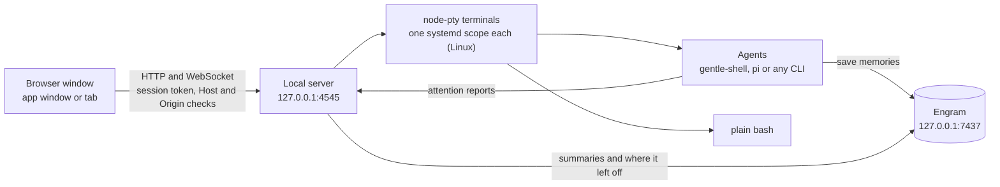
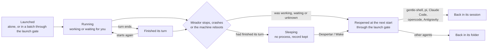

# Mirador

A local dashboard for your project folders, with agent terminals inside it. Start with the [Quickstart](#quickstart); [what it does](#what-it-does) comes after.

[](https://github.com/mata-2p/mirador/actions/workflows/test.yml) [](https://github.com/sponsors/mata-2p) [](https://ko-fi.com/matiasjbarriah) [](LICENSE)

[Why Mirador](#why-mirador) · [Quickstart](#quickstart) · [What it does](#what-it-does) · [How it works](#how-it-works) · [Gentle names](#gentle-names-in-the-code) · [Demo](#demo) · [Configuration](#configuration) · [Development](#development)

<picture>
  <source media="(prefers-color-scheme: dark)" srcset="docs/img/overview-dark.png">
  
</picture>

## Why Mirador

What Mirador focuses on:

- **Where it left off.** Each project shows where its last session stopped, read from persistent memory (Engram) or, for Claude Code, from a small local record of its last messages, and a [tracking view](docs/attention.md#tracking-view) follows the day.
- **Resource control.** [One systemd scope per agent](docs/agents.md#one-systemd-scope-per-terminal) (Linux), a [launch gate](docs/agents.md#opening-many-agents-without-filling-the-memory) that waits for free memory, [idle agents that sleep](docs/agents.md#sleeping-agents-lazy-restore) and [MCP servers per project](docs/agents.md#mcp-servers-per-project).
- **Back after a reboot.** Agents [come back](docs/agents.md#reopening-agents-after-a-restart) to their folder and, with gentle-shell, pi, Claude Code, opencode or Antigravity, to their session.
- **Mirador itself stays on the machine.** Zero telemetry, no accounts; the server listens on `127.0.0.1` only. That is Mirador, not the agents running inside it: Claude Code, pi or any other agent still talks to its own provider. In the full mode the night shift and **Mejorar con IA** send their prompts to Claude through pi, and the night shift writes to a Telegram bot only once you connect your own. For **Dónde quedó / Where it left off**, Mirador keeps your last message to Claude Code, its last answer and its compaction summary in plaintext under `~/.local/state/mirador/left-off/` (0600, 30 days by default, `leftOff: false` turns it off); they are never sent anywhere ([details](docs/attention.md#where-it-left-off)).
- **A browser window.** No GPU, Vulkan or desktop session needed, and inside WSL2 it opens in the Windows browser.
- **Native gentle-shell, pi and Engram integration**, while any terminal agent or a plain `bash` works too.

If you need remote machines over SSH, a phone app or a single Rust binary, [Herdr](https://herdr.dev) (Apache-2.0) does those today and Mirador does not. Mirador has no relation to Herdr: the `herdr` names in its code are a gentle-shell compatibility layer ([`bin/herdr-shim`](#gentle-names-in-the-code)), and Mirador neither ships nor runs Herdr.

Mirador is an independent project, not an official part of gentle-shell; it builds on [gentle-shell](https://github.com/Gentleman-Programming/gentle-shell), pi and Engram, and thanks that community.

## How Mirador compares

Other tools run coding agents side by side too. The table lists what each one's own site or repository said on 2026-11-21. A dash means its official pages do not say; each project's site is the source of truth and things change.

| | Form | Platforms | License | Agents in git worktrees | Remote machines and phone |
|---|---|---|---|---|---|
| **Mirador** | Local web dashboard in a browser window | Linux, WSL2; macOS experimental | Apache-2.0 | No | No app; you can [reach it through an `ssh -L` tunnel](docs/security.md#opening-mirador-from-another-machine), and the inbox is usable on a phone's browser through the same tunnel ([experimental](docs/attention.md#the-phone-inbox-is-experimental)) |
| [Herdr](https://herdr.dev) | Desktop app; Herdr TUI in the terminal | macOS (Apple silicon), Linux, Windows | Apache-2.0 | — | SSH; iPhone, iPad and Android apps |
| [Paradev](https://paradev.com) | Desktop app, plus CLI, SDK and MCP server | macOS; Linux experimental; no Windows yet | MIT | Yes | iPhone and iPad app |
| [Claude Code Desktop](https://code.claude.com/docs/en/desktop) | The Code tab of the Claude desktop app | macOS, Windows; Linux beta (Ubuntu, Debian) | — | Optional, per session | SSH sessions; cloud sessions in the Claude mobile app |
| [cmux](https://github.com/manaflow-ai/cmux) | Native macOS terminal app | macOS only | GPL-3.0-or-later (server parts BUSL-1.1) | — | SSH; iPhone app in beta |
| [Emdash](https://github.com/generalaction/emdash) (Classic) | Desktop app | macOS, Windows, Linux | Apache-2.0 | Yes | SSH/SFTP |

## Quickstart

This path needs neither gentle-shell nor Engram: each folder opens a plain `bash`, and the Gentle extras stay hidden.

**Language.** The interface follows the browser's language (Spanish for `es-*`, English otherwise) until you choose one in **Ajustes / Settings** (the sliders button at the top right) → **Idioma / Language**, with **EN** or **ES**; interface text in this README is quoted as Spanish / English.

**Requirements**

| Need | Why |
|------|-----|
| Linux, macOS (experimental) or WSL2 | the launcher and the terminals; systemd scopes only where `systemd-run` works |
| curl and git | the one-line install downloads its script with curl; the install from source also clones Mirador with git, and a manual install needs git. The prebuilt release (Linux x64 and arm64, below) needs no git. Minimal images such as Debian's ship neither: `sudo apt install curl git` |
| Node 24 or newer | Mirador runs its TypeScript sources directly. Where the distribution packages an older Node (Debian 13, for example), install it with [mise](https://mise.jdx.dev), as `install.sh` suggests: `curl https://mise.run \| sh`, add `eval "$(~/.local/bin/mise activate bash)"` to `~/.bashrc`, open a new terminal, then `mise use -g node@24` |
| pnpm 12 | installs the dependencies, among them `node-pty`, which compiles (next row). pnpm 12 is the major CI installs the lockfile with: `mise use -g pnpm@12`, or with the corepack that ships with Node 24, `corepack enable pnpm && corepack install -g pnpm@12` |
| python3, make and a C++ compiler; on macOS the Xcode Command Line Tools | `node-pty` compiles with them. Debian and Ubuntu: `sudo apt install python3 make g++`; Fedora: `sudo dnf install python3 make gcc-c++`; Arch: `sudo pacman -S python make gcc`; macOS: `xcode-select --install` |
| a Chromium-family browser (Chromium, Chrome, Brave, Edge or Vivaldi) for the app window; any other browser opens Mirador as a tab | the window (see [Browser](docs/configuration.md#browser)). On Debian: `sudo apt install chromium`. Without a display, `bin/mirador` prints the link to open by hand |

**Install**

Clone this repository, go into it and run the installer there:

```sh
git clone https://github.com/mata-2p/mirador.git
cd mirador
./install.sh                 # or ./install.sh --root ~/code to set the workspace folder
```

The installer works on the clone it belongs to wherever you run it from (`mirador/install.sh` works too); run from another folder, its messages name the clone's files by their full path.

On Linux x64 and arm64 with glibc 2.28 or newer, one line installs the prebuilt release, with nothing to compile (**Prebuilt release (Linux)** below). On other Linux systems it clones Mirador into `~/.local/share/mirador` (`$XDG_DATA_HOME/mirador` when that is set), or updates that clone, and runs the clone's installer from the folder you are in; read [the script](scripts/bootstrap.sh) before running it:

```sh
curl -fsSL https://raw.githubusercontent.com/mata-2p/mirador/main/scripts/bootstrap.sh | sh
```

**Prebuilt release (Linux).** On Linux x64 and arm64 with glibc 2.28 or newer, the line installs the release pinned in the script, Mirador 0.2.0, which bundles Node and a built `node-pty`, so it needs no git, Node, pnpm or compiler, and the Node, pnpm and compiler rows of the requirements do not apply. It downloads `mirador-<version>-linux-<arch>.tar.gz` from GitHub Releases, checks it against the sha256 written in the script before unpacking it into `~/.local/share/mirador/<version>`, points `~/.local/share/mirador/current` at it, runs its doctor and adds the launcher; it takes no installer options. When `~/.local/share/mirador` is already a git clone, it leaves it as it is, stops and says how to keep the clone or move it away; any other folder there it also leaves alone and asks you to move away, except one that holds only the `.download.XXXXXX` folders of a first install cut off abruptly (a power cut, a killed terminal): it removes those, saying `bootstrap.sh: removed …, a download an earlier run left half done` for each, and installs. It never checks for updates: running the line again is how you update. When a Mirador server is running during an update, it says, after pointing `current` at the new version, `bootstrap.sh: a Mirador server is running, and it keeps running Mirador <previous version> until you restart it with: mirador stop && mirador`. With an older glibc it says `bootstrap.sh: the prebuilt release needs glibc 2.28 or newer (found: …), so Mirador installs from source` and installs from source; macOS and other systems keep the install from source too. [docs/releasing.md](docs/releasing.md) says how a release is built and pinned.

For the install from source, installer options go after `sh -s --`, as in `curl -fsSL … | sh -s -- --root ~/code`. Run it as your own user: as root, or with `sudo`, it refuses and changes nothing, because Mirador installs into your home folder. You stay in your folder, so the installer names the clone's files in full: it ends with `start Mirador with: /home/you/.local/share/mirador/bin/mirador`, and when something is missing it says to run `/home/you/.local/share/mirador/install.sh` again (running the same line again works too). When git cannot clone, it says `bootstrap.sh: could not download Mirador from …` and exits 1.

Keep the `-f` of `-fsSL`: with it, a failed download (a 404, no network) makes curl print the error, for example `curl: (22) The requested URL returned error: 404`, and pass nothing to `sh`, instead of an error page that `sh` would try to run. `sh` then runs nothing, but with a pipe the line still exits 0, so look for that curl line. A download cut short runs nothing either: the script prints `bootstrap.sh: this copy of the script is incomplete (the download was cut short), so nothing ran; download it again` and exits 1. To make any failed download stop with a non-zero exit, save the script, read it, then run it:

```sh
curl -fsSLO https://raw.githubusercontent.com/mata-2p/mirador/main/scripts/bootstrap.sh && sh bootstrap.sh
```

It checks Node, pnpm, the build tools and, on Linux, a browser first (the browser with the same check as `pnpm run doctor`, or, before Node 24 is there, a shell check of the same browsers); for each missing one it prints why Mirador needs it and the command that installs it (pacman, apt, dnf, zypper, brew or, for Chromium on Ubuntu, snap), and exits 1 without changing anything. On Linux without a display (no `DISPLAY` or `WAYLAND_DISPLAY`, not WSL) a missing browser is only a warning, since `bin/mirador` prints a link to open elsewhere there, and the install goes on. With apt and several items missing it also prints one `sudo apt install` command for all of them, and on Linux without pacman it gives the steps to install Node 24 with [mise](https://mise.jdx.dev). Under WSL it warns when the clone is on a Windows drive (`/mnt/c/...`), which makes installing and loading much slower; clone it in your Linux home instead. It never runs `sudo` and never installs system packages or Node. Then it runs `pnpm install --frozen-lockfile`, creates `~/.config/mirador/config.json` from `config.example.json` when there is none yet (an existing config is never touched; without `--root` it says which line to edit), runs `pnpm run doctor`, on Linux runs `bin/mirador install`, and ends with the command that starts Mirador. When `gentle-shell` or `pi` is not on `PATH`, or Engram does not answer at the config's `engramUrl` (the same check as `pnpm run doctor`), it ends with one note each on what Mirador does without it (plain mode, no pi agent, empty memory views) and how to get it; they never fail the install. `./install.sh --help` lists its options.

**The workspace folder.** Mirador shows the folders inside the `root` of each workspace. `--root <dir>` writes it into a new config: the folder must exist (otherwise `install.sh` exits 2 and changes nothing), and your shell expands `~` in `--root ~/code` before `install.sh` sees it. Without `--root`, the new config keeps the example's `/home/you/code` and the installer says which line to edit. In the config file, `root` must be the full path of an existing folder, and `~` is not expanded there. Left at `/home/you/code`, or naming a folder that does not exist, Mirador still starts without a warning, and the folder tree shows *La carpeta de este workspace ya no existe / The folder of this workspace no longer exists* instead of folders; fix `root`, then restart Mirador (`bin/mirador stop && bin/mirador`). Workspaces added from the app accept `~/`.

**Starting it.** After the one-line install of the prebuilt release, `bin/mirador` is `~/.local/share/mirador/current/bin/mirador`. In an install from source it is in the clone: from the clone's folder it is `bin/mirador`, from anywhere else its full path, such as `~/.local/share/mirador/bin/mirador` after the one-line install from source. On Linux the installer also links `~/.local/bin/mirador`, so `mirador` works from any folder once `~/.local/bin` is on `PATH` (the installer warns when it is not). On Linux without a display (no `DISPLAY` or `WAYLAND_DISPLAY`: an SSH session, a container), `bin/mirador` still starts the server and prints the one-time link instead of opening a window: `mirador: no display (DISPLAY and WAYLAND_DISPLAY are unset), so no window opens; open this one-time link in a browser within 60 s: http://127.0.0.1:4545/#launch=…`. Run `bin/mirador` again for a new link.

- **macOS (experimental).** The app window opens with `open -na` in Google Chrome, Brave Browser, Microsoft Edge, Vivaldi or Chromium; with none of them, `open` shows Mirador as a tab in the default browser. There are no systemd scopes, so terminals run without memory limits: the server turns them off without probing, `doctor` says so and the **Consumo / Usage** pane says *Límites no disponibles en macOS / Limits are not available on macOS*, and free memory is read with `sysctl` and `vm_stat`. node-pty 1.1.0 ships its macOS `spawn-helper` without the execute bit; the server adds it at startup. The installer does not run `bin/mirador install`; run it yourself to add only the `~/.local/bin/mirador` link (macOS gets no app menu entry).
- **WSL2.** Mirador runs as on Linux. With no Linux Chromium browser, `bin/mirador` opens the window's URL with `wslview` when it is present, else in a Microsoft Edge app window through `powershell.exe` (recent Ubuntu releases ship no `wslu`), else as a tab through `xdg-open` when it is present, and otherwise prints the URL to open in a Windows browser. The one-time link lasts 60 seconds from the launcher's request, because starting `powershell.exe` and Edge in a VM can take over 10 seconds, and the page redeems it as soon as it opens.
- **Windows.** Windows native is not supported: Mirador relies on POSIX signals, process groups, systemd scopes and `/proc`. WSL2 with `systemd=true` in `/etc/wsl.conf` is the supported path, and the app window opens in Edge on the Windows side.

To report a bug, run `pnpm run doctor --report` and paste the fenced block it prints: OS and version, kernel, architecture, Node, pnpm, node-pty, the browser found, systemd scopes, the mode and which agents are on `PATH`. After the one-line install of the prebuilt release, which bundles Node and has no pnpm, run `~/.local/share/mirador/current/node/bin/node ~/.local/share/mirador/current/src/doctor.ts --report` instead, from any folder; it prints the same block, with `pnpm: not found`. It holds no path under your home folder, no user or host name, and nothing from the config besides the mode.

**Manual steps**

The same steps by hand, instead of `./install.sh`:

1. Clone this repository, then install from its folder with pnpm 12 (Node 24 and pnpm as in the requirements above):

   ```sh
   git clone https://github.com/mata-2p/mirador.git
   cd mirador
   pnpm install
   ```

2. Copy the example config, then set `root` to the full path of an existing folder of yours (`~` is not expanded there; see **The workspace folder** above):

   ```sh
   mkdir -p ~/.config/mirador
   cp config.example.json ~/.config/mirador/config.json
   ```

   It holds one workspace, `"agentCommand": "bash"` (a plain shell per folder; put `claude`, `opencode` or another agent there later) and `"mode": "auto"`. Every key is in [Configuration](#configuration).

3. Check the machine:

   ```sh
   pnpm run doctor
   ```

   It lists Node, node-pty and a browser (required: it exits 1 when one is missing; on Linux without a display the browser is optional), then systemd, gentle-ai, each agent it knows and Engram (optional: they only inform). When gentle-shell, pi or Engram is missing, a **Not found** part gives one line each: what Mirador does without it (plain mode with one bash per folder, no pi agent or session restore, empty memory views such as "where it left off") and how to get it ([gentle-shell](https://github.com/Gentleman-Programming/gentle-shell), which also starts pi; `engram serve` for Engram, see [Use](docs/configuration.md#use)). The exit code stays 0 when only these are missing.

4. Start it:

   ```sh
   bin/mirador
   ```

   The server starts and an app window opens; without a display it prints the link to open instead. `bin/mirador stop` stops it. To have `mirador` on `PATH`, run `bin/mirador install` (Linux and macOS: it links `~/.local/bin/mirador`). Where `systemd-run --user --scope` works, each terminal runs in its own systemd scope; elsewhere Mirador starts without them.

**Modes.** `mode` is `auto`, `gentle-deck` or `plain`. `gentle-deck` is the full mode: memory, night shift and Pi MCP. `auto` picks the full mode when gentle-ai's `~/.gentle-ai/state.json` exists or `gentle-shell` is on `PATH`, and plain mode otherwise. The app is called Mirador in both.

## What it does

A local dashboard for your project folders. Each row links to the full description in `docs/`.

| Capability | In one sentence |
|------------|-----------------|
| [Where it left off](docs/attention.md#where-it-left-off) | **Dónde quedó / Where it left off** shows each folder's last worked day and the next steps of its latest session summary, read from Engram, or Claude Code's last message and yours when that is newer, kept locally for 30 days (`leftOffDays`). |
| [Tracking view](docs/attention.md#tracking-view) | **Seguimiento / Tracking** swaps the layout for a read-only overview of agents in lanes by what they need from you. |
| [Attention inbox](docs/attention.md#attention-inbox) | **Te esperan (N) / Waiting for you (N)** lists the agent terminals that need your answer or finished their turn. |
| [One systemd scope per terminal](docs/agents.md#one-systemd-scope-per-terminal) | On Linux each terminal runs in its own systemd user scope, so an out-of-memory kill takes one terminal, not all of them. |
| [Launch gate for memory](docs/agents.md#opening-many-agents-without-filling-the-memory) | Agents opened in a row start in batches and wait while free memory is under the reserve. |
| [Sleeping agents](docs/agents.md#sleeping-agents-lazy-restore) | After a restart, agents that had finished their turn sleep with no process until you wake them. |
| [Reopening after a restart](docs/agents.md#reopening-agents-after-a-restart) | Open agents come back at the next start, in their folder and, with gentle-shell, pi, Claude Code, opencode or Antigravity, in their session. |
| [Opening several agents](docs/agents.md#opening-several-agents) | Mark folders in selection mode, or save them as the workspace's projects, and open one agent in each. |
| [MCP servers per project](docs/agents.md#mcp-servers-per-project) | Turn off the MCP servers a folder does not need, which saves memory in every agent opened there. |
| [Browser window](docs/configuration.md#browser) | A Chromium-family browser opens Mirador as an app window; any other browser gets a tab, and the `browser` key overrides the choice. |
| [Changes](docs/features.md#what-it-does) | **Cambios / Changes** shows a folder's or workspace's changes against its last commit, staged and unstaged together, with each file's diff coloured by line; it only reads the repository. |
| [Browser notifications](docs/attention.md#attention-inbox) | Off until you click **Activar avisos del navegador / Turn on browser notifications** in the inbox; then an agent that starts waiting for you or stops with an error shows one browser notification, with Mirador's icon, the project and reason as its title and the question, agent and path in its body (it may arrive up to 1.5 s after the card, and 3 or more within 1.5 s share one notification; a discreet mode hides the details), and finished turns never do. |
| [Night shift](docs/attention.md#tracking-view) | In the full mode, the **Piloto automático / Autopilot** answers agents' questions while you are away, on a schedule or switched on by hand, leaves sensitive actions for you and reports each move in the tracking view. |
| [File editor](docs/features.md#file-editor) | **Archivos / Files** edits a folder's text files, dotenv files first, and asks before overwriting an agent's change. |
| [Security](docs/security.md#security) | The server listens on `127.0.0.1` only and checks a session token, the `Host` header and, on every change, the app's own `Origin`. |

To open Mirador from another machine, forward its port with `ssh -L` after reading the risks: [Opening Mirador from another machine](docs/security.md#opening-mirador-from-another-machine).

Workspaces, the folder tree, terminals as tabs or a grid, the daily summary, the night shift's settings and resource profiles are in [docs/features.md](docs/features.md). Contributing: [CONTRIBUTING.md](CONTRIBUTING.md); reporting a vulnerability: [SECURITY.md](SECURITY.md).

## How it works

One local server, started by `mirador`, runs every terminal with node-pty and serves the UI to a browser window on the same machine. Agents report when they wait for you, and Engram, when it runs, supplies the memory behind the summaries and **Dónde quedó / Where it left off**. The modules and the data flow are in [docs/how-it-works.md](docs/how-it-works.md).



An agent's life across restarts ([details](docs/agents.md#reopening-agents-after-a-restart)):



## Gentle names in the code

Mirador grew up next to the Gentle tools, so a few of their names show up in the code, the config and `doctor`. None
of them is needed for the plain mode.

| Name | What it is | What Mirador does with it |
|------|------------|---------------------------|
| gentle-ai | The Gentle setup tool for AI agents; it records the agents it configured in `~/.gentle-ai/state.json` (`GENTLE_AI_HOME` moves it). | Reads that file only: its `installed_agents` add agents to the agent picker, and the file's presence makes `mode: "auto"` pick the full mode. `pnpm run doctor` reports it. |
| Engram | A local persistent-memory server that agents save their session summaries to. | Reads it at the config's `engramUrl` (`http://127.0.0.1:7437` by default) for the daily summary and [where it left off](docs/attention.md#where-it-left-off). Without it those views are empty, except where it left off for a folder where Claude Code ran in Mirador. |
| gentle-deck | The internal name of the full mode (memory, night shift and Pi MCP), kept as the config value `mode: "gentle-deck"`. | Nothing on screen: the app is called Mirador in every mode. Where the old name stays and why: [CONTRIBUTING.md](CONTRIBUTING.md#the-name-gentle-deck-in-the-code). |
| `bin/herdr-shim` | A gentle-shell compatibility layer: gentle-shell reports what an agent is doing with `herdr pane report-metadata`, and the shim answers that command. It has no relation to the Herdr product ([herdr.dev](https://herdr.dev)); Mirador neither ships nor runs Herdr. | Agent terminals get `HERDR_BIN_PATH` pointing at the shim, which forwards each report as one JSON line to a Unix socket under `<runtime>/mirador/herdr/`, feeding the [attention inbox](docs/attention.md#attention-inbox). It prints nothing, always exits 0 and gives up after one second. |

## Demo


| Where it left off | Attention inbox | Tracking view |
|---|---|---|
|  |  |  |

## Known limits

- Without systemd scopes, `mirador stop` can leave alive processes an agent started in the background ([#1](https://github.com/mata-2p/mirador/issues/1)). Scopes are off with `MIRADOR_SCOPES=0`, with `scopes: false` in the config, on macOS, and on Linux or WSL2 where `systemd-run --user --scope` does not work.
- Once you have seen an agent's finished or error card, the sidebar, its tab and its pane show it as working; Tracking still shows its real state ([#12](https://github.com/mata-2p/mirador/issues/12)).

## Configuration

`~/.config/mirador/config.json`. Workspace changes from the UI write only `workspaces`; every key is optional:

```json
{
  "workspaces": [
    { "id": "dev", "name": "Dev", "root": "/home/you/Dev", "folders": ["tools", "web"], "expanded": ["web"] }
  ],
  "port": 4545,
  "engramUrl": "http://127.0.0.1:7437",
  "agentCommand": "gentle-shell",
  "ignore": ["node_modules", "bin", "obj", "dist", "build", "target", "coverage", "__pycache__"],
  "timeZone": "America/Santiago"
}
```

What each key does, the `browser` override, the commands (`mirador link | status | stop | logs`) and a broken config: [docs/configuration.md](docs/configuration.md). The launch gate's `launches` settings: [docs/agents.md](docs/agents.md#opening-many-agents-without-filling-the-memory).

Terminals run in systemd scopes where `systemd-run --user --scope` works. `MIRADOR_SCOPES=0` in the environment, or `"scopes": false` in the config, turns them off: [One systemd scope per terminal](docs/agents.md#one-systemd-scope-per-terminal).

## Development

```sh
pnpm test                 # node --test 'test/**/*.test.ts'
```

New features plug in as one route module and one UI module each; [docs/extending.md](docs/extending.md) lists the shared helpers, events, DOM slots and the lines each feature registers on. [docs/releasing.md](docs/releasing.md) is for maintainers: cutting a release, reviewing its draft and the promotion PR that pins it in `scripts/bootstrap.sh`.

## Author

Mirador is created by Matías Barría ([@mata-2p](https://github.com/mata-2p)), founder of [ZURAI](https://zurai.cl).
Need custom software or consulting? Get in touch with ZURAI at [zurai.cl](https://zurai.cl).

## License

Mirador is released under the [Apache License 2.0](LICENSE). You can use, modify and redistribute it, also commercially, as long as you keep the notice ([NOTICE](NOTICE)); contributors grant a patent licence for their contributions.

## Sponsoring

Mirador is free and funded by donations: monthly tiers are on GitHub Sponsors and one-off tips on Ko-fi, both described in [SPONSORS.md](SPONSORS.md). Nothing in the app is paid, and there is no telemetry.
